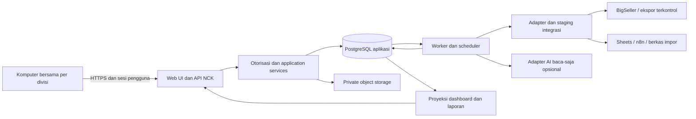
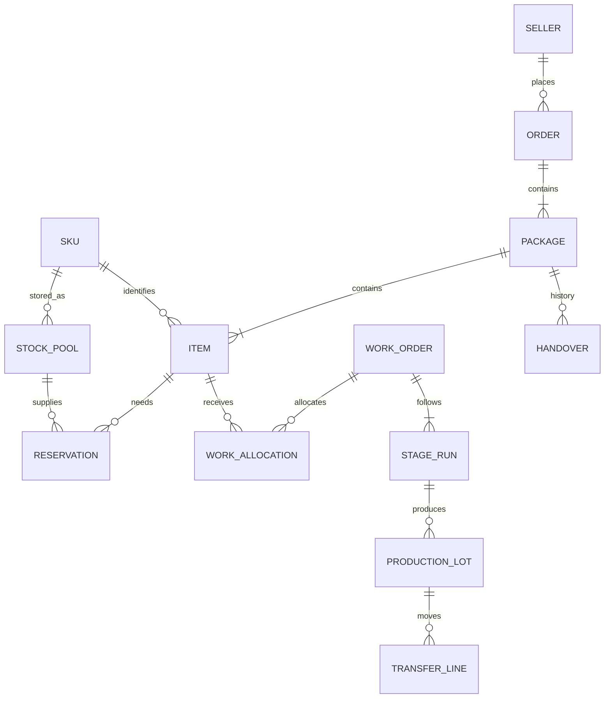

# TRD — NCK Operations Control Center

Technical Requirements Document · Versi 0.1 · 1 November 2026 · Asia/Jakarta

**Status: draft rancangan teknis untuk review. Belum ada aplikasi dibangun, kredensial diminta, koneksi diaktifkan, atau deployment dijalankan.**

Dokumen induk: [BRD v0.1](BRD-NCK-v0.1.md), [PRD v0.1](PRD-NCK-v0.1.md), dan [FRD v0.1](FRD-NCK-v0.1.md). Kebijakan bisnis dalam dokumen tersebut tetap berlaku. TRD tidak mengubah kewenangan admin atau menyelesaikan parameter bisnis TBD secara sepihak.

## 1. Ringkasan keputusan teknis

Seluruh pilihan teknologi dan angka layanan dalam TRD ini adalah **usulan**, bukan pembelian, komitmen layanan, atau konfigurasi yang sudah ada. Versi runtime dan library akan dikunci setelah pemeriksaan kompatibilitas dan dukungan keamanan saat implementasi.

| ADR | Usulan | Alasan untuk NCK / konsekuensi |
|---|---|---|
| ADR-01 | Modular monolith: satu codebase dengan modul domain; proses web dan worker terpisah | Transaksi lintas order/stok/produksi tetap sederhana; modul bisa dipisah nanti berdasarkan bukti beban |
| ADR-02 | Python + Django untuk backend dan UI awal berbasis template dengan JavaScript seperlunya | Form operasional dan aturan domain dikelola satu tim/codebase; UI antrean interaktif menggunakan endpoint JSON yang sama |
| ADR-03 | PostgreSQL sebagai database transaksi aplikasi | Relasi, constraint, locking, dan riwayat cocok untuk alokasi dan kuantitas; bukan pengganti otoritas stok BigSeller |
| ADR-04 | Worker berbasis antrean durable di PostgreSQL dan transactional outbox | Mengurangi komponen pilot; perlu lease, retry, deduplikasi, dan monitoring yang eksplisit |
| ADR-05 | HTTPS satu origin; session server-side per pengguna | Mempermudah komputer bersama dan pencabutan sesi; tidak memakai akun divisi bersama sebagai identitas aktor |
| ADR-06 | Adapter BigSeller/Sheets/n8n, dimulai dari impor terkontrol bila perlu | Tidak bergantung pada API yang belum diperiksa; write-back nonaktif sampai kontrak sumber terbukti |
| ADR-07 | Saldo operasional terhitung + ledger kejadian kuantitas dan rekonsiliasi sumber | Memungkinkan pelacakan koreksi dan mencegah double count; full event sourcing tidak diperlukan |
| ADR-08 | Polling dashboard awal; event streaming opsional setelah kebutuhan dibuktikan | Konsistensi tidak bergantung pada koneksi browser terus hidup |
| ADR-09 | Hosting managed database + proses aplikasi/worker + private object storage | Backup dan operasi lebih terkelola; penyedia, lokasi, biaya, dan SLA belum dipilih |
| ADR-10 | AI opsional melalui adapter baca-saja | Kegagalan AI tidak menghambat transaksi; penyedia/model belum dipilih |

Django menyediakan batas transaksi `atomic`, dan PostgreSQL menyediakan row locking. Keduanya dapat mendukung desain transaksi di bawah, tetapi aturan FIFO, otorisasi, dan pencegahan overselling eksternal tetap tanggung jawab rancangan aplikasi. [Transaksi Django](https://docs.djangoproject.com/en/5.2/topics/db/transactions/), [Locking PostgreSQL](https://www.postgresql.org/docs/current/explicit-locking.html).

Pilihan alternatif seperti frontend SPA, Redis/broker, atau microservices dievaluasi hanya jika kompleksitas UI, antrean, atau beban terukur membutuhkannya. Tidak ada benchmark atau inspeksi lingkungan deployment yang sudah dilakukan.

## 2. Arsitektur dan batas kepercayaan



Panah ke sumber luar menunjukkan batas adapter yang direncanakan, bukan koneksi aktif. Aplikasi tidak mengakses database sumber secara langsung. Browser tidak memegang kredensial integrasi atau akses langsung database.

Jalur sinkron: login, validasi order, reservasi, hasil tahap, transfer, handover, persetujuan. Respons sukses hanya setelah commit transaksi terkait.

Jalur asinkron: impor, sinkronisasi, rekalkulasi ETA, rekomendasi stok, pembentukan laporan, notifikasi internal, dan AI. Antrean memiliki ID pekerjaan yang dapat dipantau. Hasil turunan tidak menjadi dasar mutasi tanpa pemeriksaan ulang keadaan aktual.

## 3. Modul dan kepemilikan data

| Modul | Tanggung jawab | Dilarang |
|---|---|---|
| Identity & Access | Pengguna, sesi, role/scope, workstation | Menganggap lokasi komputer sebagai identitas orang |
| Master Data | Seller, SKU/alias, desain, rute/versi, lokasi, kalender | Menggabungkan SKU ambigu otomatis |
| Order Management | Penerimaan, validasi, revisi, cancel, paket/item | Menulis saldo stok langsung |
| Inventory & Allocation | Pool, observasi sumber, saldo, reservasi, rekonsiliasi | Mengklaim otoritas stok eksternal tanpa kontrak |
| Production | Work order, tahapan, lot/split, rework, transfer | Menganggap seluruh batch selesai karena sebagian hasil |
| Vendor | Keluar/kembali, komitmen dan jadwal, QC kembali | Menganggap barang vendor ready stock |
| Dispatch | Picking, packing, pickup, handover | Menganggap resi dibuat sebagai terkirim |
| Planning | Kebutuhan, kalender kapasitas, ETA, rekomendasi | Mengubah prioritas/restock tanpa keputusan |
| Decisions | Usulan, persetujuan admin, invalidasi, eksekusi | Menjalankan persetujuan usang atau berulang |
| Cost & Reporting | Standar berversi, cakupan biaya, metrik, report revision | Menyamakan nilai order dengan kas/laba bersih |
| Integration | Inbox, staging, mapper, cursor, retry, watermark | Mengubah domain dengan bypass service |
| Audit & Notifications | Riwayat, kasus, notifikasi, outbox | Menyimpan data sensitif lengkap dalam log umum |

Satu modul memanggil application service modul lain; tidak mengubah tabel milik modul lain secara bebas. Service domain berbagi transaksi database saat invariant lintas modul harus dijaga.

## 4. Model data logis dan constraint

### 4.1 Konvensi

- Primary key UUID, bukan nomor resi. FK melindungi referensi; penghapusan transaksi melalui cascade tidak diperbolehkan.
- Waktu kejadian `occurred_at`, waktu diterima `recorded_at`, waktu sumber `source_updated_at` terpisah; PostgreSQL `timestamptz`, API ISO-8601 ber-offset, UI Asia/Jakarta.
- `row_version` integer untuk optimistic concurrency. Perubahan yang relevan menaikkan versi agregat.
- Jumlah pcs integer; bahan `numeric(18,6)` dengan unit. Uang `numeric(20,4)` dan currency; JSON uang berupa string decimal. Aturan pembulatan laporan ditetapkan finance; hindari binary floating point untuk uang.
- Field hilang tetap NULL dengan indikator kualitas; NULL tidak otomatis nol. Parameter bisnis menyimpan `status = draft/approved`, versi, effective time, sumber, serta approver.
- Setiap tabel operasional memiliki `company_id`; NCK satu perusahaan internal. Seller bukan tenant internal atau akun login pada versi pertama.
- Semua FK lintas objek memeriksa perusahaan yang sama. Pemeriksaan server wajib, walaupun hanya satu perusahaan aktif.

### 4.2 Kelompok tabel inti

| Tabel / kelompok | Kolom/relasi penting | Constraint / indeks utama |
|---|---|---|
| users, roles, user_roles, sessions, workstations | aktor, scope divisi, versi hak | sesi dapat dicabut; scope dievaluasi setiap command |
| sellers, seller_terms_versions | ketentuan penggunaan stok, referensi, berlaku | riwayat ketentuan immutable setelah dipakai |
| skus, sku_aliases, design_versions, route_versions | kategori, unit, versi siap desain | unique alias per akun sumber; SKU kode unik dalam perusahaan |
| orders, order_revisions | seller, source_received_at, application_received_at, validated_at, queue_at, status | indeks `(company_id,status,queue_at,id)`; versi order |
| packages, waybill_history, package_items | order, ekspedisi, resi aktif, item quantity versi | satu resi aktif per paket; konflik resi lintas paket ditinjau, bukan global unique tanpa audit sumber |
| external_refs | source_account, entity_type, external_id, internal_id | unique `(source_account,entity_type,external_id)` |
| stock_pools | SKU, lokasi, kondisi, shared/exclusive, entitled_seller | exclusive wajib seller; shared tidak memiliki entitled_seller |
| stock_observations, observation_rows | sumber, snapshot/version, scope, effective_at, received_at, raw ref | snapshot hanya dipromosikan bila scope lengkap tervalidasi |
| allocation_guards, pool_balances | company+SKU coordinator, pool, versi saldo, gross/net mapping | baris coordinator unik; saldo/ledger harus diperbarui dalam transaksi sama |
| reservations, reservation_events | item, pool, reserved/picked/used/released quantities | kuantitas nonnegatif; total transisi tidak melebihi reservasi |
| quantity_events, quantity_postings | operation_id, bucket asal/tujuan, lot, qty, reversal_of | operation_id unik; koreksi referensi event asal; kuantitas berpindah seimbang |
| reconciliation_cases, source_matches | event lokal, source transaction/snapshot, qty tercermin, bukti | satu efek tidak dapat dipakai dua kali; partial match eksplisit |
| work_orders, work_allocations, stage_runs | route/design version, order/restock, item coverage | alokasi jumlah diperiksa under lock terhadap kebutuhan dan output |
| production_lots, lot_lineage, stage_results | parent/split lot, hasil baik/hold/scrap, pelaksana | rework merujuk lineage lama; unit unik tidak diciptakan ulang |
| transfers, transfer_lines, receipts | asal/tujuan, kirim/terima, mismatch | receipt unik per kejadian; jumlah diterima kumulatif dibatasi |
| vendor_jobs, vendor_shipments, vendor_returns | work lot, jumlah, due original/current | saldo vendor dihitung dari arus; revisi due tersimpan |
| blockers, blocker_actions | objek, qty terdampak, PIC, mulai/resolusi | indeks kasus aktif per objek/PIC |
| pickup_sessions, packing_checks, handovers | tanggal/jadwal, konfirmasi, package version, bukti | satu handover aktif per paket; koreksi melalui reversal berwenang |
| capacity_versions, calendar_versions, schedule_runs, schedule_slots | resource group, waktu/qty, dependencies | jadwal snapshot; slot overlapping tidak melampaui capacity model |
| recommendation_runs, recommendation_lines, forecast_inputs | policy/input hash, pool, bucket, qty, constraint | immutable run; status stale saat dependency berubah |
| decisions, decision_executions | admin, object version, input hash, alasan | execution key unik per keputusan/tahap pelaksanaan |
| cost_versions, cost_components, order_cost_snapshots | cakupan standar, biaya tambahan, sumber | versi historis tidak ditimpa; decimal |
| metric_definitions, report_runs, report_members | cutoff, kohort, revisi, kontribusi order/item | report versi dapat direproduksi dari snapshot/ref kejadian |
| integration_inbox, import_batches, import_rows, sync_cursors | raw checksum, mapper version, status | dedup per sumber/event; cursor commit setelah data durable |
| command_receipts, outbox_events, jobs, consumer_receipts | idempotency hash, event/attempt/lease | unique command scope+key; unique consumer+event |
| audit_entries, attachments, notification_cases | aktor, reason, target, private object key | audit append-only bagi role aplikasi; akses lampiran terotorisasi |

Constraint lintas banyak baris seperti total alokasi <= stok tidak cukup memakai `CHECK` pada satu baris. Service transaksi mengunci coordinator/saldo terkait, memeriksa agregat, lalu menulis ledger dan projection bersama. Constraint dasar tetap di DB sebagai lapisan tambahan.

### 4.3 Relasi utama



Lot berbasis kuantitas dan lineage cukup untuk pilot; serial number setiap kaos tidak diwajibkan. Hasil dari satu batch dapat dibagi ke banyak item, dan satu item dapat dipenuhi banyak lot tanpa menghilangkan jejak jumlah.

## 5. Transaksi, FIFO, dan invariant

### 5.1 Batas transaksi

Command bisnis berjalan dalam explicit transaction. Validasi otorisasi, idempotency, versi, prasyarat, mutasi domain, audit, dan outbox commit bersama. Panggilan jaringan dan AI tidak dilakukan sambil memegang row lock.

Gunakan isolation level dasar dengan row locks terarah; transaksi kompleks dapat memakai serializable bila hasil uji membuktikan perlu, dengan retry terkontrol. Urutan lock global harus konsisten: coordinator SKU diurutkan ID → order/item → saldo pool → reservasi/lot → keputusan terkait sesuai command plan yang terdokumentasi. Command yang menyentuh paket multi-SKU memperoleh seluruh coordinator dalam urutan yang sama sebelum membaca ulang state.

Deadlock/serialization retry memakai idempotency key yang sama dan batas percobaan. Tidak mengembalikan sukses sebelum commit. Transaksi singkat; pengguna tidak boleh menahan lock saat menunggu konfirmasi UI.

### 5.2 Alokasi unit terakhir dan urutan order

Row lock saja tidak menjamin FIFO bisnis. Allocator di bawah coordinator SKU memilih kebutuhan eligible menurut aturan FRD: pengecualian admin → queue_at → ID. Command manual tidak boleh mengambil saldo melewati order lebih awal tanpa exception beralasan.

Alur:

1. Autentikasi/otorisasi dan registrasi command key.
2. Lock coordinator SKU dan kebutuhan eligible; baca ulang versi sumber, saldo, hak seller, dan urutan.
3. Lock pool eligible dengan urutan stabil; hitung jumlah yang dapat dialokasikan sesuai model bruto/neto yang disahkan.
4. Buat reservasi serta efek komitmen, tingkatkan versi, catat audit/outbox, commit.
5. Order kekurangan tetap kekurangan; queue worker menghitung kebutuhan produksi tanpa membuatnya dua kali.

`SKIP LOCKED` hanya untuk pengambilan job independen, bukan untuk melewati kebutuhan order pertama dalam allocator. Order yang datang belakangan dengan timestamp historis lebih awal tidak mencabut reservasi selesai otomatis; flag ke admin untuk evaluasi. FIFO berlaku pada kebutuhan yang diketahui dan eligible pada saat keputusan.

### 5.3 Produksi, transfer, dan rework

Lock stage/lot yang diubah; validasi jumlah tersedia, pindahkan antar bucket kuantitas, simpan result/event dan projection secara atomik. Pengiriman memindahkan dari siap transfer ke dalam perjalanan; penerimaan memindahkan ke input tahap berikutnya. Selisih tidak otomatis masuk scrap.

Rework memindahkan kuantitas hold ke proses ulang menggunakan lineage sama. Hasil ulang menambah aktivitas proses tetapi tidak menambah input unit unik. Pembatalan order melepaskan hubungan kebutuhan yang aman; tidak menghapus lot, transfer, atau kerja vendor.

### 5.4 Persetujuan dan handover

Persetujuan menyimpan versi objek dan hash dependency. Saat eksekusi, kunci keputusan dan objek, bandingkan input terkini, validasi kewenangan admin masih berlaku, dan gunakan unique execution key. Perubahan relevan membuat status `requires_review`; admin memutuskan ulang, tanpa persetujuan pemilik tambahan.

Handover mengunci paket dan item terkait, memeriksa kelengkapan, QC, packing, resi aktif, reservasi/picking, serta belum adanya handover aktif. Buat event handover dan consumption yang semantiknya sudah dipetakan ke BigSeller; satu paket gagal tidak boleh menghasilkan sebagian status terkirim. API bulk mengembalikan hasil per paket, bukan sukses total palsu.

## 6. Integrasi BigSeller: kontrak dan mode aman

### 6.1 Otoritas

BigSeller tetap sumber resmi stok fisik. Aplikasi NCK adalah otoritas progres produksi, kasus, keputusan, serta alokasi lokal jika model itu akhirnya disahkan. Local ledger merupakan catatan operasi/rekonsiliasi; tidak otomatis menjadi pengganti BigSeller.

Audit integrasi wajib membuktikan: akun/source ID, SKU alias, lokasi/kondisi, bruto atau neto, reservasi sumber, mutasi dan ID-nya, waktu snapshot, pagination/scope, cancellation/return, izin baca/tulis, limit, retry, dan mekanisme penarikan data. Tidak ada endpoint BigSeller yang diasumsikan tersedia dalam TRD ini.

### 6.2 Mode bertahap

| Mode | Syarat | Perilaku |
|---|---|---|
| M0 — Impor terkontrol | CSV/ekspor dan field dapat dipetakan | staging, preview, validasi, konfirmasi PPIC; tidak disebut real-time |
| M1 — Sinkron baca | Akses resmi dan perubahan dapat diamati | polling/webhook sesuai kemampuan terbukti; waktu data terlihat; reservasi eksternal tetap perlu strategi |
| M2 — Koordinasi reservasi/write-back | Dukungan resmi, otoritas tunggal, dan kontrak retry/reconcile terbukti | command keluar dengan status pending/ack/unknown/failed; aktif hanya untuk operasi yang lolos audit |

Pilot bisa memakai M0. Sebelum menjanjikan stok, diperlukan aturan satu jalur alokasi atau reservasi resmi yang mencegah penulis eksternal mengambil unit sama. Jika itu belum ada, konfirmasi PPIC hanya mengurangi risiko; tidak menjamin atomisitas dengan aktivitas luar. Label alokasi tetap provisional, risiko dicatat, dan cakupan pilot harus membatasi penulis eksternal secara operasional.

### 6.3 Snapshot dan pencocokan efek

1. Simpan file/payload mentah privat, checksum, account, mapper version, waktu efektif/diterima, scope dan kualitas timestamp.
2. Muat semua halaman/baris ke staging. Jangan mengganti saldo dengan potongan snapshot yang belum lengkap; scope per SKU/lokasi harus eksplisit.
3. Tolak promosi snapshot lama berdasarkan sequence/version sumber bila tersedia. Jika hanya timestamp lemah, tandai ambigu dan rekonsiliasi manual.
4. Cocokkan event lokal dengan ID mutasi sumber atau bukti rekonsiliasi. Kecocokan jumlah total saja tidak membuktikan event sudah tercermin.
5. Dalam transaksi terkunci, promosikan snapshot dan perbarui inclusion marker untuk setiap delta/komitmen sehingga satu efek diterapkan tepat sekali dalam projection.
6. Jika tidak ada data mutasi yang cukup, jangan otomatis meniadakan delta lokal. Buat cutoff rekonsiliasi yang dikonfirmasi PPIC dengan daftar kejadian dan saldo; snapshot berikutnya mengikuti baseline baru.

Formula FRD dipakai setelah normalisasi: saldo bruto + delta terverifikasi belum tercermin − komitmen aktif belum tercermin dalam arus fisik. Komitmen tidak dikurangi lagi bila saldo sumber sudah neto. Setiap adapter memiliki fixture bruto/neto/retry/out-of-order untuk membuktikan pemetaan.

### 6.4 Tidak ada transaksi terdistribusi semu

Database lokal dan BigSeller tidak dianggap bisa commit atomik bersama. Outbound intent disimpan bersama outbox; worker mengirim setelah commit. Timeout respons eksternal menjadi `outcome_unknown`, bukan langsung diulang bila sumber tidak mendukung deduplikasi. Query status/reconcile dahulu. External acknowledgement tidak menggandakan ledger yang sudah dicatat lokal.

Sumber read-only tidak menerima write-back. Tidak menggunakan browser automation sebagai pengganti integrasi produksi tanpa rancangan dan otorisasi terpisah.

## 7. Kontrak API internal dan event

### 7.1 Standar command

API internal `/api/v1`; versi ini usulan kontrak aplikasi NCK, bukan API BigSeller. Session cookie HttpOnly/Secure, CSRF pada request mutasi, scope server-side. Setiap mutasi memakai `Idempotency-Key`; edit agregat memakai `If-Match`/`expected_version`.

Kunci idempotensi unik pada company + authenticated actor/client + command type + key; simpan hash payload. Key sama/payload sama mengembalikan receipt hasil awal; key sama/payload berbeda → `409 IDEMPOTENCY_CONFLICT`. Unique ID sumber/event bisnis tetap berlaku walau cache respons kedaluwarsa.

| Endpoint usulan | Fungsi dan respons penting |
|---|---|
| `POST /imports`, `GET /imports/{id}` | Terima file → 202 + job ID; rincian order berhasil/konflik/gagal |
| `POST /orders/{id}/validate` | Validasi semua item dan revisi terkait |
| `POST /orders/{id}/revisions` | Usulan perubahan berversi dengan dampak |
| `POST /orders/{id}/cancel` | Batalkan kebutuhan yang eligible, tangani picked/WIP |
| `POST /allocations/commands` | Jalankan allocator, bukan edit saldo bebas |
| `POST /stages/{id}/results` | Hasil parsial baik/hold/scrap |
| `POST /transfers`, `POST /transfers/{id}/receipts` | Kirim dan terima terpisah |
| `POST /vendor-jobs/{id}/returns` | Kembali parsial ke antrean QC |
| `POST /packages/{id}/packing-checks` | Konfirmasi versi item/packing |
| `POST /packages/{id}/handovers` | Serah-terima aktual dengan bukti |
| `POST /planning/runs`, `GET /planning/runs/{id}` | Rekomendasi/ETA asinkron dan versi input |
| `POST /decisions/{id}/approve`, `/reject`, `/execute` | Otorisasi admin, versi, dedup execution |
| `GET /dashboards/operations`, `/reports/{id}` | Data dengan watermark, coverage, dan drilldown |
| `GET /commands/{receipt_id}` | Memeriksa hasil simpan yang timeout |
| `GET /attachments/{id}/download` | Otorisasi baru sebelum akses file privat |

Contoh payload sintetis hasil tahap:

```json
{
  "expected_version": 7,
  "lot_id": "<uuid>",
  "good_qty": 8,
  "hold_qty": 2,
  "scrap_qty": 0,
  "occurred_at": "2026-11-01T11:00:00+07:00",
  "performer_team_id": "<uuid>",
  "reason": "Dua pcs perlu pemeriksaan ulang"
}
```

Actor/recorded_at ditentukan server, bukan dipercaya dari payload. Server menolak hasil melebihi jumlah input yang tersedia. Respons menyertakan entity ID/version, command receipt ID, committed_at, data freshness, serta warning kualitas bila ada.

Kode: 400 format salah; 401 tidak login; 403 tidak berhak; 404 objek tidak terlihat; 409 versi/stock/idempotency conflict; 422 aturan bisnis/prasyarat tidak terpenuhi; 429 pembatasan; 503 layanan sementara tak tersedia. Error memuat code, pesan Indonesia, field_errors, request_id, retryable; tidak memuat stack trace atau data seller lain.

### 7.2 Event dan job

Envelope: `event_id`, `type`, `schema_version`, `aggregate_id`, `aggregate_version`, `occurred_at`, `recorded_at`, `correlation_id`, `causation_id`, actor reference, dan payload minimal tanpa PII yang tidak diperlukan.

Contoh: `OrderValidated`, `AllocationChanged`, `StageResultRecorded`, `TransferReceived`, `VendorReturnRecorded`, `PackageHandedOver`, `StockSnapshotPromoted`, `DecisionApproved`, `ReconciliationOpened`.

Outbox ikut commit domain. Worker claim memakai lease dan `SKIP LOCKED`, retry dengan backoff/jitter, maksimum percobaan konfigurabel; gagal berulang masuk dead-letter dengan PIC. Pengiriman event bersifat at-least-once; consumer dedup melalui unique `(consumer,event_id)`. Jangan mengklaim exactly-once network delivery.

Job lama tidak boleh menimpa projection versi baru. Event per agregat diproses berurutan atau consumer menghitung ulang state terbaru secara idempoten. Coalesce rekalkulasi ETA untuk objek yang sama sambil mempertahankan watermark. Worker mati setelah commit tetapi sebelum ack harus aman untuk replay.

## 8. Planning engine dan estimasi pengiriman

### 8.1 Mesin hitung deterministik

Perhitungan dipisah dari AI. Setiap run mencatat input snapshot, policy/calendar/capacity versions, mapper version, algorithm version, horizon, asumsi, missing fields, dan hasil. Unit waktu dan jumlah konsisten; hasil bisa direproduksi pada input sama.

Baseline mengikuti rumus FR-07: kebutuhan pasti K, forecast total F, permintaan tambahan U, stok bruto terhadap kebutuhan yang dihitung, WIP tepat waktu, saldo per bucket, dan usulan Q. Flag forecast semantics wajib; mencegah pending ikut dua kali. Pool shared dan exclusive memiliki cakupan kebutuhan yang saling jelas, bukan dijumlahkan sembarangan.

Untuk data kurang, keluarkan `insufficient_data` atau skenario manual berlabel. Tidak mengisi target stok, kapasitas cutting, minimum batch, atau batas modal secara otomatis. Stok nol dan data hilang berbeda.

### 8.2 Penjadwalan kapasitas

Representasikan tahap sebagai dependency graph per lot/transfer, dengan resource group dan kalender. Kapasitas adalah total divisi, tidak dikalikan jumlah mesin tanpa model baru yang tervalidasi. Semua order dan restock menggunakan slot resource yang sama.

Run menyusun pekerjaan siap menurut prioritas FRD, memesan slot simulasi, kemudian memperkirakan transfer berikutnya. Partial flow hanya memakai jumlah yang benar-benar diterima atau transfer plan yang disetujui; tidak mengarang minimum transfer untuk membuat ETA tampak cepat.

Kebutuhan bahan, desain, vendor, cutoff dan QC/packing menjadi dependency. Vendor ±300 pcs/hari dan ±24 jam adalah parameter awal berlabel estimasi; kapasitas cutting kosong memaksa hasil parsial/manual. Lead time vendor yang mencakup perjalanan tidak ditambah transport lagi.

Hasil berisi waktu item siap, waktu paket terakhir lengkap, pickup kandidat, konfirmasi pickup, alasan risiko, dan unknowns. `confidence` versi awal berupa kategori kualitas data, bukan probabilitas sukses yang tidak dikalibrasi. Pickup 18.00 belum dikonfirmasi tidak menghasilkan janji pasti.

### 8.3 Persetujuan terhadap run

Recommendation hanya merujuk snapshot. Eksekusi memeriksa ulang dependency versions/hash terhadap data terbaru di bawah transaksi; jika berubah, keputusan `requires_review`. Versi pertama menganggap setiap input pembentuk keputusan berubah relevan, sesuai FRD. Persetujuan admin menghasilkan pekerjaan; bukan stok masuk atau pembayaran.

Backtest berjalan berdasarkan waktu data yang memang tersedia saat keputusan simulasi, dibanding praktik Rabu/tujuh hari. Histori tanpa stockout/snapshot tidak boleh dipakai untuk mengklaim hasil pending/dead stock pasti; lanjutkan evaluasi prospektif.

## 9. Reporting dan UI konsistensi

Read model dashboard diperbarui worker dengan `computed_at`, `source_as_of`, `projection_version`, dan `data_coverage`. Respons command menyediakan state aktual agar layar pelaku tidak menunggu projection untuk melihat sukses. Aksi berikutnya tetap membaca state transaksi, bukan cached dashboard.

Usulan polling layar aktif setiap 10 detik, berhenti/melambat saat tab tidak aktif; interval dikonfigurasi setelah pengujian. Umur data eksternal tetap ditampilkan terpisah. Polling cepat tidak membuat BigSeller real-time.

Laporan menyimpan metric definition version, cutoff, kohort paket/item, kuantitas versi laporan, dan komponen biaya. Late event menghasilkan revisi laporan dengan alasan, bukan overwrite angka final diam-diam. Laporan menggunakan snapshot konsisten atau dataset watermark tunggal; jangan mencampur halaman query dari state berbeda.

Margin dihitung dengan decimal dari cost version terkait. Query agregasi menjaga grain: order/paket/item tidak dijumlahkan ulang karena join ke banyak transfer atau pembayaran. Drilldown harus menghasilkan total yang sama. Total margin seller berbobot total nilai/biaya, bukan rerata persentase.

UI menampilkan saving/committed/unconfirmed/failed. Timeout sesudah klik tidak langsung dianggap gagal: cek command receipt dengan key yang sama. Jangan menyimpan payload PII di localStorage; draft sensitif hilang saat logout/switch. Offline penuh tidak dirancang pada versi pertama.

## 10. Autentikasi, otorisasi, dan data sensitif

Usulan login per karyawan memakai username/password, password tersimpan dengan hasher framework yang dikonfigurasi aman. Tidak ada password bersama per divisi. Pergantian pengguna mengakhiri sesi workstation sebelumnya dan meminta autentikasi pengguna baru; memilih nama saja tidak cukup. Idle lock diusulkan 15 menit dan maksimum sesi 12 jam, untuk divalidasi dengan pola shift. Tindakan admin sensitif memerlukan sesi admin aktif dan autentikasi ulang bila sudah melewati batas freshness yang disepakati.

Permission berbentuk aksi + scope objek/divisi + perusahaan. Pengelola sistem tidak otomatis mendapat kewenangan bisnis admin. Export, search, download, background report, dan AI memanggil policy yang sama. Job menyimpan requester dan memeriksa hak saat menghasilkan serta menyerahkan hasil; hak yang dicabut tidak tetap hidup di URL lama.

Gunakan HTTPS, cookie Secure/HttpOnly/SameSite, CSRF pada mutasi browser, rate limit login, session revocation, escaped output, validasi file, dan query terparameterisasi. Framework membantu menyediakan perlindungan, tetapi konfigurasi dan pengujian aplikasi tetap diperlukan. [Panduan keamanan Django](https://docs.djangoproject.com/en/5.2/topics/security/).

Lampiran masuk karantina: cek ukuran, tipe nyata, malware bila fasilitas tersedia, lalu aktifkan hanya bila lolos aturan upload. CSV export menetralkan formula spreadsheet pada input tak tepercaya. Bukti/desain disimpan privat dengan akses berumur pendek setelah otorisasi; jangan memakai public bucket. Retensi file/PII belum disahkan.

Secret disimpan di secret manager/env deployment, tidak di repository, browser, file impor, atau log. Integrasi memakai kredensial terpisah dengan scope minimum; token dirotasi dan dicabut saat insiden. Database tidak diekspos publik; role aplikasi dibatasi, role migrasi dipisah.

Audit merekam actor/recorder/performer, sumber, timestamp, before/after yang diperlukan, reason, correlation ID. Mask PII di log operasional. Append-only melalui hak aplikasi bukan jaminan audit kebal administrator DB; kebutuhan penyimpanan audit tahan perubahan lebih kuat dievaluasi terpisah.

## 11. AI boundary

AI provider/model belum dipilih. Adapter hanya menerima konteks terotorisasi dan diperlukan: metrik agregat, ID kasus, sumber waktu, serta kebijakan yang disetujui. Hindari mengirim nama/alamat/telepon penerima untuk analisis stok.

Tidak memberi akses SQL bebas, kredensial BigSeller, atau tool write. Fungsi baca memakai parameter tervalidasi dan scope pengguna. Teks impor/desain/catatan dianggap data tak tepercaya; tidak boleh menjadi instruksi untuk membuka data lain atau mengambil tindakan.

Output terstruktur: fakta, perhitungan dari sistem, dugaan, rekomendasi, sumber, missing_data. Server memeriksa referensi ada dan dapat diakses. Angka KPI tetap dari mesin hitung. Cache terikat scope pengguna/versi kebijakan dan data, bukan global lintas hak.

Budget, timeout, rate limit, retensi provider, lokasi pemrosesan, dan evaluasi kualitas menjadi keputusan sebelum aktivasi. Feature flag AI off tidak memengaruhi transaksi utama.

## 12. Deployment dan operasional

Usulan tiga environment: development dengan data sintetis, staging dengan data disamarkan, production dengan akses terbatas. Tidak menyalin data pribadi produksi ke development tanpa proses sanitasi.

Deployment awal: satu layanan web, satu worker, scheduler dengan lease tunggal, managed PostgreSQL, private object storage, ingress HTTPS, dan monitoring. Web/worker dapat ditambah replika setelah terukur; job/event durable tetap di DB. Pilot satu replika memiliki risiko outage saat failure; strategi rolling/dua replika dievaluasi terhadap biaya dan target availability.

Pipeline yang direncanakan: lint/type check sesuai stack → unit/property tests → PostgreSQL integration tests → API/security tests → migration rehearsal → staging UAT → release terkendali. Build reproducible dengan dependency lockfile dan image digest; versi keamanan diverifikasi sebelum release.

Migrasi schema memakai expand → deploy kompatibel → backfill idempoten → verifikasi → contract pada release berikutnya. Backup sebelum perubahan berisiko tidak menggantikan rehearsal. Hindari rollback schema yang menghapus transaksi baru; rollback aplikasi hanya jika schema kompatibel, selain itu forward-fix.

Feature flags terpisah untuk impor, mode reservasi, write-back, ETA otomatis per kategori, rekomendasi, dan AI. Setiap flag menampilkan status operasional agar tim tidak salah mengira fitur aktif.

Biaya belum dihitung: compute web/worker, DB/PITR, storage/egress, monitoring, domain, AI, serta konektivitas kantor. Penyedia/region dipilih setelah budget, internet lokasi, data residency yang diinginkan, dan penanggung jawab operasi jelas. Tidak ada layanan berbayar dibuat oleh dokumen ini.

## 13. SLO, performa, dan skalabilitas — usulan awal

Angka berikut **target uji rancangan**, bukan hasil benchmark atau SLA yang disetujui.

| Ukuran | Usulan target pilot | Cara membuktikan |
|---|---|---|
| API transaksi inti | p95 <= 1 detik di sisi server, tidak termasuk pihak luar | Load test command campuran dan kontensi SKU |
| Layar utama | p95 <= 2 detik pada perangkat/jaringan uji yang dicatat | Browser timing di lokasi pilot |
| Refresh proyeksi internal | p95 <= 15 detik setelah commit pada beban uji | Selisih event commit dan watermark dashboard |
| Kehilangan/duplikasi efek | Nol kehilangan commit terkonfirmasi dan nol efek ganda pada skenario retry | Fault injection dan rekonsiliasi ledger |
| Availability | Target awal 99,5% bulanan, untuk review biaya/operasi | Synthetic check dan catatan insiden; belum komitmen |
| Sinkron sumber | Belum ditentukan | Mengikuti akses, interval, limit, dan semantik sumber yang dibuktikan |

Profil uji awal sintetis: 30 pengguna aktif, burst 10 command/detik selama 10 menit, impor 10.000 paket × 3 item, histori 1 juta item dan 5 juta kejadian. Angka ini adalah envelope benchmark untuk dikalibrasi, bukan prediksi volume NCK. Ukur waktu impor dan tetapkan budget setelah hardware dipilih; impor tidak boleh membuat transaksi inti melampaui target.

Target 100.000 pcs/bulan tidak langsung menjadi request/detik: petakan paket per hari, item per paket, tahapan/kejadian per pcs/batch, pengguna bersamaan, serta burst pagi/pickup. Skalakan dari hasil profiling: indeks/query → batching/projection → worker terpisah → kapasitas DB → pemisahan layanan hanya bila bottleneck terukur.

Indeks prioritas: antrean status/waktu, reservasi aktif per pool/item, stage aktif per divisi, pending vendor/due, event aggregate/version, source refs, job due/lease, dan handover tanggal. Pagination berbasis cursor pada daftar besar. Partitioning event/report dipertimbangkan setelah volume dan query membenarkan.

## 14. Observability, backup, dan pemulihan

### 14.1 Monitoring

Log terstruktur dengan request/command/event/job ID. Dashboard teknis: error/latency, DB locks/deadlocks, antrean tua/retry/dead-letter, lag projection, umur snapshot sumber, jumlah konflik, rekonsiliasi terbuka, dan backup age. Alert terpisah untuk kegagalan teknis dan hambatan bisnis.

Usulan peringatan pilot: job inti menunggu >5 menit, backup gagal, sumber melewati ambang freshness yang disetujui, atau invariant saldo tidak cocok. Nilai threshold teknis dapat dikalibrasi; ambang bisnis tidak diisi otomatis. PIC insiden dan jadwal dukungan harus ditunjuk sebelum pilot.

### 14.2 Backup dan recovery

Usulan RPO <=15 menit dan RTO <=4 jam untuk database; ini target yang harus diuji dan dibiayai. Usulan retensi backup 30 hari, latihan restore bulanan serta sebelum perubahan besar. Retensi transaksi/PII produksi tetap keputusan tersendiri.

Gunakan base backup dan pengarsipan WAL/PITR yang terverifikasi melalui layanan DB; dump logis tambahan berguna untuk portabilitas tetapi bukan pengganti rantai PITR. [Dokumentasi PITR PostgreSQL](https://www.postgresql.org/docs/current/continuous-archiving.html).

Object storage memakai versioning/backup sesuai penyedia. DB menyimpan checksum dan status objek. Uji recovery mencakup berkas bukti, konfigurasi, secret recovery, dan pemetaan event, bukan database saja. RPO/RTO lampiran tidak boleh diam-diam dianggap sama jika mekanisme berbeda; pilih target dan uji sebelum pilot.

Runbook restore:

1. Hentikan mutasi dan integrasi keluar; catat watermark terakhir yang diketahui.
2. Pulihkan DB ke environment terisolasi dan verifikasi checksum/constraint/rekonsiliasi.
3. Pulihkan/cek lampiran; tandai berkas hilang sebagai exception.
4. Cocokkan handover, stok sumber, dan tindakan eksternal setelah titik recovery. Jangan replay outbox write-back otomatis sebelum status eksternal diketahui.
5. Periksa receipt, inbox, cursor, dan job supaya restore tidak mengeksekusi persetujuan atau mutasi dua kali.
6. Rekonsiliasi dengan PPIC/admin, jalankan smoke test, baru buka write dan integrasi bertahap.

Saat aplikasi tidak tersedia, gunakan formulir sementara bernomor unik untuk order/hasil/handover; petugas memasukkan ulang dengan waktu kejadian asli dan ID sementara. Metode distribusi formulir, akses, dan PIC disepakati sebelum pilot. Tidak mengandalkan pengiriman ulang bebas tanpa deduplikasi.

## 15. Migrasi data dan rollout

1. **Discovery:** ambil sampel ekspor terotorisasi, inventaris field, arti saldo, histori sejak Mei 2026, dan ketentuan seller. Belum dilakukan oleh TRD.
2. **Mapping:** seller/SKU/alias/ukuran, ID sumber, waktu/zone, resi sebagai teks, status batal, harga, dan scope stok. Versi mapper disimpan.
3. **Staging:** profil duplikat, data hilang, invalid quantity, ambiguity, dan timestamp; laporan cakupan per periode. File asal dipertahankan privat sesuai retensi.
4. **Rehearsal:** impor ke staging; hitung total paket/item/pcs dan nilai yang datanya lengkap; cocokkan dengan sumber. Jangan mengisi histori tahap yang tidak ada.
5. **Cutover pilot:** pilih seller/SKU/divisi; catat opening snapshot, active reservations, WIP, vendor outstanding, pending order, dan watermark sumber. Crosswalk active reservation sumber mencegah reservasi ganda.
6. **Shadow mode:** rekomendasi/ETA dibanding keputusan aktual; belum otomatis mengubah pekerjaan.
7. **Operasional pilot:** satu jalur pencatatan per jenis kejadian disepakati. Tidak memaksa tim input transaksi identik di dua sistem tanpa mekanisme rekonsiliasi jelas.
8. **Evaluasi/perluasan:** UAT, saldo, backlog, kualitas data, waktu input, serta KPI bisnis bersama. Target/durasi perlu disahkan melalui FRD TBD-09.

Rollback pilot menghentikan fitur terkait dan kembali ke prosedur sumber dengan ekspor kejadian sejak cutover untuk rekonsiliasi. Jangan menghapus transaksi valid atau restore DB lama di atas pekerjaan baru tanpa pemeriksaan. Feature rollback berbeda dari disaster recovery.

## 16. Strategi pengujian dan traceability

Skenario di bawah adalah rencana pengujian, **belum dijalankan**.

| Lapisan | Pengujian | Trace FRD |
|---|---|---|
| Unit dan property | Konservasi kuantitas, rework bukan unit baru, decimal margin, kebutuhan tidak double count, denominator nol | FR-00,04,07,08; U06,U07,U18,U19,U22,U25 |
| DB transaction | Dua allocator bersamaan, FIFO eligible, cancel vs handover, transfer vs koreksi, approval dieksekusi dua kali | FR-01,02,03,09; U03,U09,U13,U20 |
| Integration contract | Snapshot bruto/neto, partial pagination, source older, retry, mutasi tercermin sekali, outcome unknown | FR-02,12; U01,U02,U14,U21 |
| API | Payload/version conflict, forbidden transitions, kuantitas berlebih, duplicate command, status lookup timeout | FR-00,01,04,06 |
| End-to-end operasional | Paket multi-SKU, vendor parsial/QC, pickup kondisional, cutting unknown, resi bukan handover, missed pickup | FR-05,06; U05,U08,U10,U11,U17,U26 |
| Access/security | Scope seller/divisi, direct ID, export/file/job/AI access, user switch, revoked session, upload dan CSV injection | FR-09,10; U04,U16,U24 |
| Planning/report | Restock stale, trend turun, mutasi bukan penjualan, biaya kosong, late event revision, agregasi tanpa join ganda | FR-07,08; U12,U15,U23 |
| Fault injection | Worker crash setelah commit, koneksi putus setelah command, outbox replay, backup restore dan source reconciliation | FR-00,12 |
| Performance | Kontensi hot SKU, import sambil produksi, histori report, burst sebelum pickup | Target bagian 13 |

Concurrency tests memakai PostgreSQL sesungguhnya dengan dua atau lebih koneksi; SQLite/mock tidak cukup membuktikan locking. UAT U01–U26 tetap acceptance bisnis; tests teknis tidak menggantikannya. Semua rejection harus memverifikasi tidak ada perubahan parsial tak sah.

Gates release: tidak ada invariant kuantitas gagal; tidak ada celah hak akses kritis terbuka; kontrak integrasi mode aktif lulus; UAT sesuai scope lulus; rekonsiliasi opening dan pilot cocok atau exception disetujui dengan cakupan jelas; restore drill memenuhi target yang disetujui; PIC operasional menerima runbook. ETA otomatis/rekomendasi/AI dapat tetap nonaktif bila dependensinya belum siap.

## 17. Keputusan terbuka dan urutan implementasi

| Gate | Dependency | Yang dapat dikerjakan sebelum selesai | Yang belum boleh dianggap siap |
|---|---|---|---|
| G01 | FRD TBD-01: semantik stok/integrasi | Adapter contract, staging, ledger, fixture sintetis | Komit stok lintas sistem/write-back |
| G02 | TBD-02: queue timestamp/KPI | Simpan timestamp/revisi dan metrik mentah | FIFO kebijakan final/KPI resmi |
| G03 | TBD-03: cutting/kalender/transfer | Catat progres parsial dan ETA manual | ETA otomatis untuk jalur data kurang |
| G04 | TBD-04–06: policy stok/eksklusif/umur | Scenario engine, approval, indikator umur | Target stok otomatis/ambang resmi |
| G05 | TBD-07: PIC/akses/backup admin | Role framework dan audit | Akses production dan eskalasi final |
| G06 | TBD-08: biaya/finance | Versioned cost, kelengkapan, estimasi | Omzet/laba aktual terverifikasi |
| G07 | TBD-09 + ADR hosting/security | Infrastructure design dan load fixtures | SLA, budget, tanggal go-live |

Urutan pembangunan yang diusulkan setelah izin coding: fondasi auth/master/audit → impor & order → stock/reservation/reconciliation → produksi/vendor/dispatch → dashboard/biaya standar → planning/approval → AI opsional. Setiap tahap memiliki tests dan migrasi sendiri; staging/pilot baru dibuka setelah gate terkait terpenuhi.

TRD tidak menetapkan durasi sprint atau biaya tanpa mengetahui tim pengembang, hosting, volume sumber, dan mekanisme integrasi. Keputusan teknologi dicatat dalam ADR versi berikutnya jika review memilih alternatif.

## 18. Referensi dan batas verifikasi

- Kebutuhan bisnis/fungsional mengikuti BRD, PRD, FRD lokal dan klarifikasi pemilik yang dirujuk di sana.
- Dokumentasi primer transaksi, locking, keamanan framework, dan backup telah diperiksa untuk mendasari mekanisme teknis; versi dokumentasi bukan otomatis versi deployment yang dipilih.
- Arsitektur, schema, endpoint, parameter SLO, dan profil uji adalah usulan khusus NCK. Tidak ada hasil benchmark, audit API BigSeller, pemeriksaan akun, atau uji restore yang diklaim sudah selesai.

Area review utama: keputusan arsitektur (1–3), saldo dan integrasi (5–6), API/worker (7), planning (8), akses (10), target operasi/pemulihan (13–14), serta gates (17).
